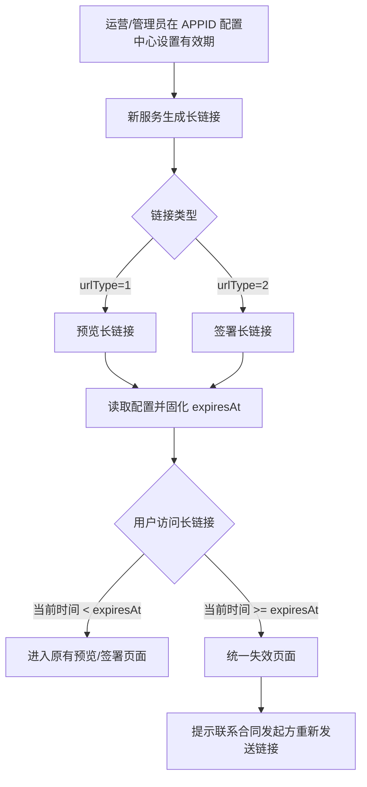

# 迁移后长链接有效期与失效页面设计

- 日期：2026-09-04
- 来源：`assets/api迁移范围参考/M-1 迁移接口参数手册.md` 遗留问题第 4 点
- 关联范围：F-004 国内站 OpenAPI × ePaaS 迁移 M-1
- 状态：设计已获用户确认，待规格审查

## 1. 背景与目标

M-1 迁移前，签署长链接永久有效。为满足合规要求，新服务生成的长链接必须由 APPID 配置控制有效期，最长不超过两年；链接超时后，签署方或查看方应看到明确的失效提示，而不是进入原有业务页面。

目标：

1. 新服务生成的签署长链接和预览长链接均受 APPID 有效期配置约束。
2. 有效期在生成时读取并固化，配置修改不影响已生成链接。
3. 超时链接展示统一、面向签署方的失效页面，引导其联系合同发起方重新发送链接。
4. 保持 V3 API 调用方式、字段结构和短链接行为兼容。

## 2. 方案范围与边界

### 2.1 纳入范围

- 新服务生成的 `urlType=2` 签署长链接。
- 新服务生成的 `urlType=1` 预览长链接。
- APPID 配置中心中的长链接有效期配置。
- 长链接服务端访问有效性校验。
- 统一长链接失效页面。

### 2.2 不纳入范围

- 旧服务改造及迁移前已生成的存量长链接：继续由旧服务按永久有效逻辑处理。
- `data.shortUrl` 签署短链接：继续沿用现有 90 天规则，不受新配置控制。
- 签署流程过期、撤销、拒签等业务状态页面：沿用现有逻辑。
- 对外 API 响应新增有效期字段：不新增 `urlExpireTime`、`urlExpireDays` 等字段。
- 开放平台新增开发者配置入口或 API 配置修改能力。

## 3. 整体链路

## 4. 配置设计

新增（或由配置平台登记）APPID 级配置，建议编码为 `longLinkValidityDays`；最终编码由研发与配置平台确认。

| 属性 | 规则 |
|---|---|
| 配置名称 | 签署长链接有效期 |
| 配置粒度 | APPID |
| 类型 | 整数 |
| 单位 | 天 |
| 合法范围 | 1～730（含边界） |
| 默认值 | 730 天 |
| 维护方 | 平台运营/管理员 |
| 管理入口 | 现有 APPID 配置中心 |
| 开发者修改 | 不支持 API 修改，不新增开放平台入口 |
| 审计 | 记录操作人、操作时间、变更前值、变更后值 |

配置平台负责保证保存值为 1～730 的整数，并拒绝 0、负数、小数、非数字和超过 730 的值。本需求不定义新服务对非法配置值的兜底策略。

## 5. 功能设计

### 5.1 长链接生成与有效期固化

适用接口：`POST /v3/sign-flow/{signFlowId}/sign-url`。

1. 新服务识别当前请求所属 APPID。
2. 生成 `urlType=1` 或 `urlType=2` 的长链接时读取 APPID 的 `longLinkValidityDays`。
3. 以服务端生成成功时间 `generatedAt` 为起点，计算 `expiresAt = generatedAt + longLinkValidityDays × 24 小时`。
4. 将 `expiresAt` 与长链接服务端记录绑定并持久化。
5. 返回原有 `data.url` / `data.shortUrl` 结构，不对外返回失效时间。

同一流程重新调用获取签署链接接口时，新链接按调用时最新配置重新计算；每个长链接独立拥有自己的固化失效时间。

### 5.2 长链接访问校验

校验必须在服务端完成，不依赖浏览器本地时间或仅依赖前端参数。

- 当前时间早于 `expiresAt`：按链接类型进入原有预览页或签署页。
- 当前时间等于或晚于 `expiresAt`：阻止原页面继续加载，展示统一失效页面。
- 链接不存在、令牌非法等场景：沿用现有无权访问/非法链接处理逻辑，不误判为超时。
- 流程已过期、撤销、拒签等：沿用原有流程状态页面，不改为长链接失效页面。

### 5.3 失效页面

签署长链接和预览长链接超时均使用同一页面和文案：

> **链接已失效，请联系合同发起方重新发送链接。**

页面约束：

- 面向签署方/查看方，不面向开发者。
- 不展示 API 路径、APPID、`signFlowId`、配置天数或具体失效时间。
- 不提供刷新、重试、自动获取新链接或调用接口按钮。
- 不跳转 `redirectConfig`。
- 页面样式遵循现有无权访问/异常页面规范。

### 5.4 存量与兼容

- 旧服务生成的存量永久链接继续由旧服务处理；新服务不要求回溯识别或改造。
- 迁移后的新服务只对自身生成的长链接执行期限校验。
- 迁移路由必须保证链接继续由所属服务处理，不发生新旧服务误判。
- `data.url`、`data.shortUrl` 的字段名、结构和调用方式保持不变。
- 短链接继续使用 90 天规则。

## 6. 数据设计

新服务至少记录以下内部数据：

| 数据项 | 说明 |
|---|---|
| 链接唯一标识 | 定位具体链接记录 |
| `signFlowId` | 关联签署流程 |
| APPID | 生成链接所属应用 |
| 链接类型 | 预览长链接或签署长链接 |
| `generatedAt` | 服务端生成时间 |
| `expiresAt` | 固化失效时间 |
| 生成服务标识 | 识别新服务来源 |
| 创建时间/更新时间 | 审计和排查 |

完整长链接不得写入普通业务日志；排查关联应使用链接标识、哈希或脱敏值，避免泄露可访问凭证。

## 7. 异常、监控与审计

### 7.1 异常处理

| 场景 | 预期行为 |
|---|---|
| 有效长链接访问 | 进入原有页面 |
| 超时长链接访问 | 展示统一失效页面 |
| 不存在或非法链接 | 沿用现有非法/无权访问处理 |
| 流程过期/撤销/拒签 | 展示原有流程状态页面 |
| 同流程再次获取链接 | 生成按最新配置计算的新链接 |

### 7.2 监控事件

记录配置变更、长链接生成（含使用的配置天数）、访问成功、超时拦截和失效页面展示；至少可按 APPID、链接类型、服务来源和时间范围统计。日志不得记录完整长链接。

## 8. 验收与测试设计

### 8.1 配置

- 默认值为 730 天。
- 配置中心允许 1～730 的整数，拒绝其他值。
- 配置变更记录操作人、时间及前后值。

### 8.2 生成

- `urlType=1` 和 `urlType=2` 均按 APPID 配置固化失效时间。
- 响应结构不新增字段。
- `data.shortUrl` 仍按 90 天规则处理。
- 配置修改不影响修改前已生成的长链接。
- 同流程重新获取链接时按最新配置生成新链接。

### 8.3 访问与页面

- 失效前访问正常进入预览/签署页面。
- 到达失效时间后展示统一文案。
- 页面不包含 API、APPID、流程 ID、开发者术语或操作按钮。
- 流程状态类失效仍展示原有状态页面。
- 客户端修改本地时间不能绕过服务端期限校验。

### 8.4 迁移兼容

- 旧服务存量永久链接行为不变。
- 新旧服务链接不发生错误归属。
- M-1 内测 APPID 完成生成、访问、超时、重新获取和端到端签署/预览验证。

## 9. 非功能要求

- 安全：服务端校验有效期；普通日志不记录完整链接凭证。
- 兼容：V3 接口路径、请求参数、响应字段及短链接行为保持不变。
- 可用性：失效文案清晰，明确告知用户联系合同发起方。
- 可审计：配置变更和有效期生成依据可追溯。

## 10. 待研发确认项

以下事项不改变已确认的产品规则，实施前由研发/配置平台确认：

1. 配置平台最终编码及现有配置项登记方式。
2. 长链接记录与 `expiresAt` 的具体存储位置、索引和清理策略。
3. 新旧服务链接来源标识及访问路由实现方式。
4. 现有异常页面规范中可复用的页面组件和路由。
5. 生成时间采用统一服务端时钟及时间精度实现。
